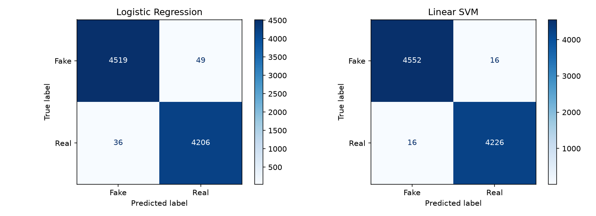
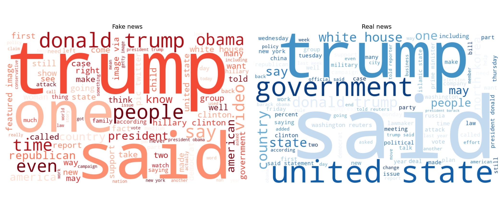

   # Task 3: Fake News Detection
   Elevvo Internship - Natural Language Processing Track

   Classifying news articles as real or fake using TF-IDF features and two classifiers (Logistic Regression and Linear SVM).

   ## Dataset
   Fake and Real News Dataset (Kaggle) by Clément Bisaillon.
   Download `Fake.csv` and `True.csv` from Kaggle and place them in a `data/` folder.

   ## Approach
   1. Loaded both files and checked for missing values and duplicates
   2. Removed duplicates and empty articles, then added labels (0 = fake, 1 = real)
   3. Removed the "(Reuters)" source prefix and the `subject` column to prevent data leakage
   4. Combined title and text, then preprocessed with NLTK (lowercasing, stopword removal, lemmatization)
   5. Split the data 80/20 (stratified), then fitted TF-IDF (unigrams and bigrams, 20,000 features) on the training set only
   6. Trained Logistic Regression and Linear SVM
   7. Evaluated with accuracy, F1-score and confusion matrices

   ## Results
   | Model | Accuracy | F1-score |
   |---|---|---|
   | Logistic Regression | XX | XX |
   | Linear SVM | XX | XX |

   

   ## Word clouds (Bonus)
   

   [Write 1-2 sentences about what stood out, e.g. which words dominate each cloud.]

   ## Limitations
   - The model learns writing style and source habits in this dataset, not whether a claim is true.
   - It may not work well on news from other sources or time periods.
   - [Add one more point from your own observations, e.g. from the top-words lists.]

   ## How to run
   1. Install Python 3.12 and run `pip install -r requirements.txt`
   2. Download the dataset into a `data/` folder
   3. Open `fake_news_detection.ipynb` and run all cells

   ## Libraries
   Python, pandas, NumPy, scikit-learn, NLTK, matplotlib, wordcloud